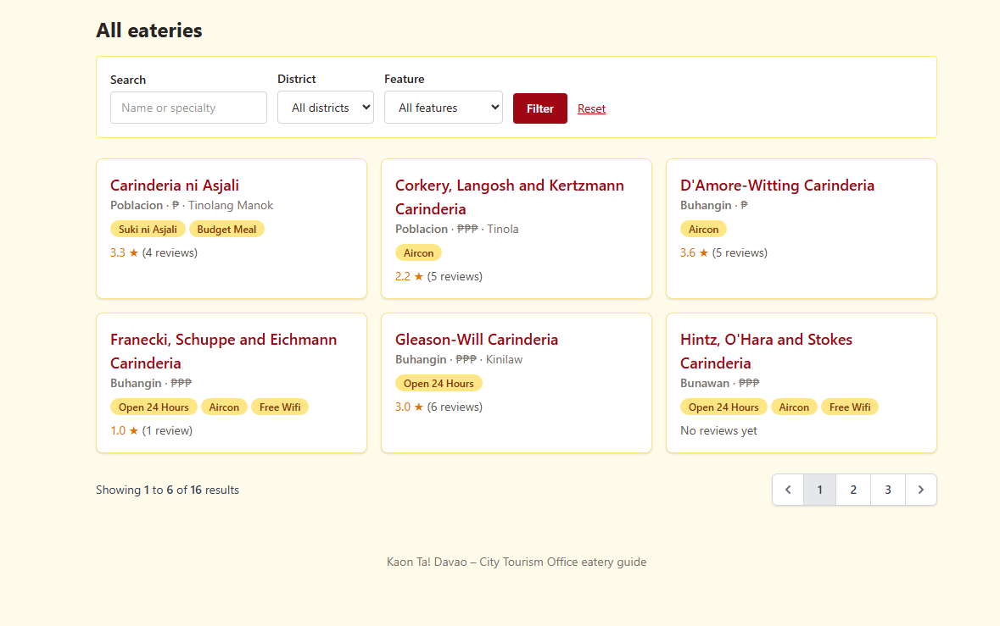
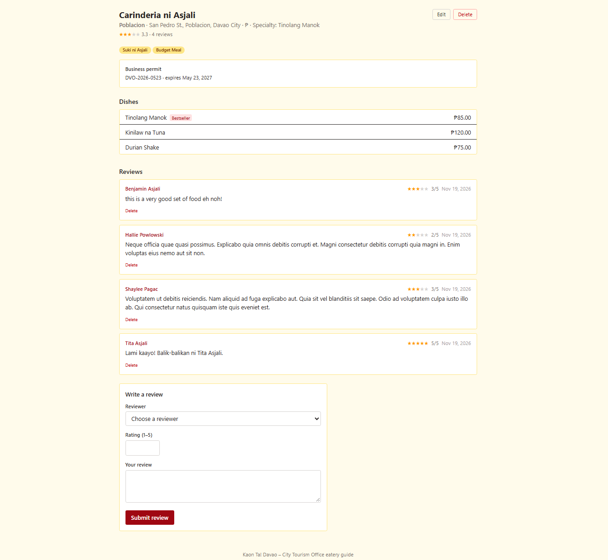
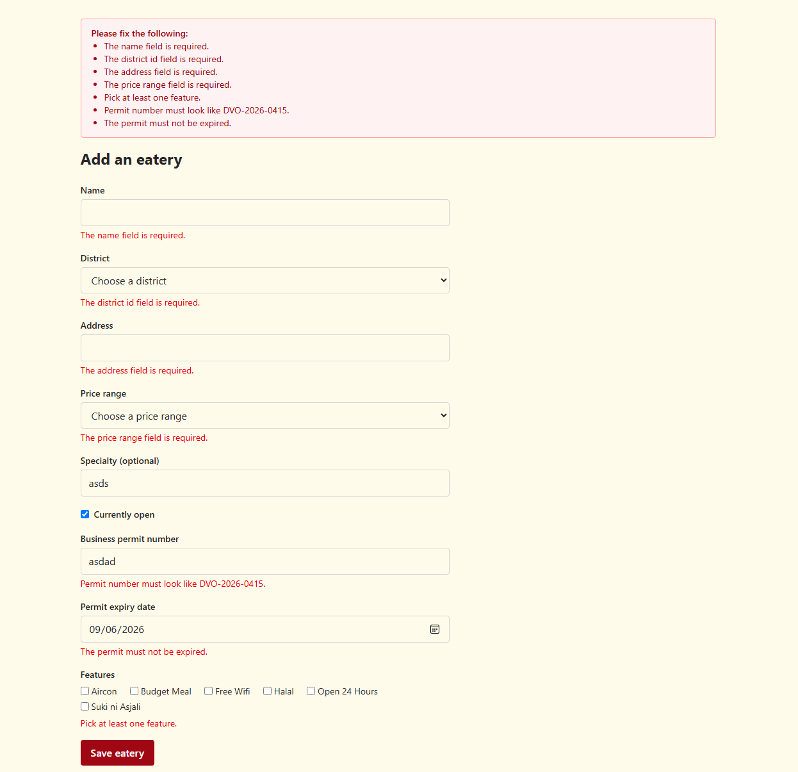

# Kaon Ta! Davao – Asjali's Food Guide

**Prefinal Project – Benjamin Asjali**

Davao City runs on its carinderias. Kaon Ta! Davao is a Laravel app for the City Tourism Office: staff list eateries by district, show each eatery's business permit, dishes and features (Halal, Budget Meal, Open 24 Hours, ...), and collect reviews from residents. There is no login; the review form has a Reviewer select filled from the seeded users.

## Setup

```bash
composer install
cp .env.example .env
php artisan key:generate
touch database/database.sqlite
php artisan migrate:fresh --seed
npm install
npm run build        # or npm run dev while developing
php artisan serve
```

Run the tests with `php artisan test`.

## Personalized data

| Item | Value |
|---|---|
| Site title | Kaon Ta! Davao – Asjali's Food Guide |
| Districts (6) | Poblacion, Talomo, Agdao, Buhangin, Toril, Bunawan |
| Features (6) | Suki ni Asjali, Budget Meal, Halal, Open 24 Hours, Aircon, Free Wifi |
| Users (12) | Benjamin Asjali (`asjali@kaonta.test`), Tita Asjali (`tita.asjali@kaonta.test`), both with password `kaonta2026`, plus 10 factory users |
| My eatery | Carinderia ni Asjali (`carinderia-ni-asjali`), Poblacion, San Pedro St., Poblacion, Davao City, budget, specialty Tinolang Manok, open |
| My eatery's features | Suki ni Asjali, Budget Meal |
| My eatery's permit | DVO-2026-0523, expires 2027-05-23 |
| My eatery's dishes | Tinolang Manok 85.00 (bestseller), Kinilaw na Tuna 120.00, Durian Shake 75.00 |
| Totals | 6 districts, 6 features, 12 users, 15 eateries (3 closed), 15 permits |

## Relationships

| Relationship | Type | Why this type fits |
|---|---|---|
| District → Eatery | hasMany | One district holds many eateries, and each eatery sits in exactly one district. |
| Eatery → District | belongsTo | The eateries table stores `district_id`, so each eatery points back to its one district. |
| Eatery → Permit | hasOne | An eatery has exactly one business permit, enforced by the unique `eatery_id` on permits. |
| Permit → Eatery | belongsTo | The permit row holds the `eatery_id`, so it belongs to a single eatery. |
| Eatery → Dish | hasMany | An eatery serves many dishes, but each dish is on one eatery's menu. |
| Dish → Eatery | belongsTo | The dish row stores `eatery_id`, so it knows which menu it is on. |
| Eatery → Review | hasMany | Many residents can review the same eatery, and each review is about one eatery. |
| Review → Eatery | belongsTo | The review row stores `eatery_id` for the eatery being reviewed. |
| User → Review | hasMany | One person can write many reviews over time. |
| Review → User | belongsTo | The review row stores `user_id`, so it has exactly one reviewer. |
| Eatery ↔ Feature | belongsToMany | An eatery has many features and a feature (like Halal) tags many eateries, so a pivot table (`eatery_feature`) is needed. |
| Feature ↔ Eatery | belongsToMany | Same many-to-many from the other side, used for the `?feature=` filter. |
| District → Review (through Eatery) | hasManyThrough | Reviews have no `district_id`; they reach a district by hopping through its eateries, which gives the "N reviews in District" count. |

## Routes

Output of `php artisan route:list --except-vendor`:

```
 GET|HEAD / .. home › HomeController
 GET|HEAD districts .. districts.index › DistrictController@index
 GET|HEAD districts/{district} .. districts.show › DistrictController@show
 GET|HEAD eateries .. eateries.index › EateryController@index
 POST eateries .. eateries.store › EateryController@store
 GET|HEAD eateries/create .. eateries.create › EateryController@create
 GET|HEAD eateries/{eatery} .. eateries.show › EateryController@show
 PUT|PATCH eateries/{eatery} .. eateries.update › EateryController@update
 DELETE eateries/{eatery} .. eateries.destroy › EateryController@destroy
 GET|HEAD eateries/{eatery}/edit .. eateries.edit › EateryController@edit
 POST eateries/{eatery}/reviews .. eateries.reviews.store › ReviewController@store
 GET|HEAD reviewers/{user} .. reviewers.show › ReviewerController@show
 DELETE reviews/{review} .. reviews.destroy › ReviewController@destroy
```

## Screenshots

| Eatery list | Eatery page with reviews | Create form with validation errors |
|---|---|---|
|  |  |  |
